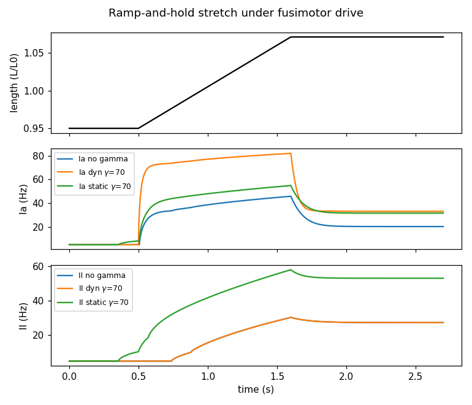
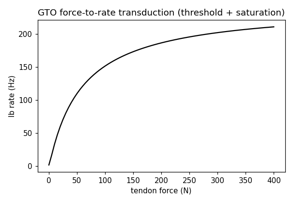

# Physiology

## Status vocabulary

- **Published formulation**: equations/parameters reproduced from the cited
  source and verified against it.
- **Engineering adaptation** (this library): structure follows the cited
  source; coefficients are documented calibration choices, not source values.

Bioafferent implements **engineering adaptations** throughout. Do not describe
its outputs as exact reproductions of published simulations.

## Muscle spindle (Ia/II)

Structural source: Mileusnic, M.P. et al. (2006), *Mathematical models of
proprioceptors. II. Structure and function of the muscle spindle*,
J. Neurophysiol. 96, 1696–1708; first-order tension reduction after Vannucci,
L. et al. (2017), *Proprioceptive feedback through a neuromorphic muscle
spindle model*, Front. Neurosci. 11:341.

Retained structure: three intrafusal fiber types (bag1, bag2, chain) with
polar/sensory tension dynamics; dynamic gamma drive acts on bag1, static gamma
on bag2/chain; II sums bag2+chain; Ia combines all three with partial
occlusion of convergent inputs; fusimotor frequency transduction via a
Hill-type equation plus low-pass filtering.

Adaptations (all coefficients in `SpindleConfig`, overridable):

1. Second-order fiber mechanics reduced to first-order relaxational tension
   dynamics per Vannucci et al. (validated there as <1% rate difference).
2. Polar contraction modelled as activation-proportional sensory preload
   (`prestretch_gain`), the mechanism for gamma-driven resting discharge.
3. Receptor transduction is a per-fiber power law `G * max(T - T0, 0)^p`.
4. Ia partial occlusion is a saturating combination `S / (1 + k*S)`.
5. Fusimotor rise times: 90% in 343 ms (dynamic) / 471 ms (static) after
   Vannucci et al. 2017, i.e. tau = t90/ln(10).
6. Numeric defaults are calibrated so the Vannucci validation stretch
   (0.95 L0 baseline, 0.11 L0/s ramp, gamma 70 spk/s) yields: Ia dynamic
   overshoot with adaptation to a tonic hold level; II length-following;
   dynamic gamma boosting Ia velocity sensitivity ~1.9x; static gamma raising
   resting/hold discharge of both afferents. They are NOT Mileusnic Table 1
   values (copyrighted, paywalled) and must not be cited as such.

## Golgi tendon organ (Ib)

Sources: Houk, J. & Simon, W. (1967) static properties (threshold, steep
low-force sensitivity, saturation); Lin, C.C.K. & Crago, P.E. (2002) dynamic
force filtering, *J. Biomech.*

Implemented: first-order low-pass on tendon force (tau 50 ms), then
`Ib = b + G*x/(1 + x/F_sat)` with `x = max(F - F_thr, 0)` — monotonic,
saturating, documented engineering combination of the reported properties.

## Spike encoding

- Poisson / inhomogeneous Poisson: per-step Bernoulli trials with `p = r*dt`;
  exact for `r*dt << 1`; `r*dt > 1` rejected loudly.
- Gamma-renewal (integer order n): exact ISI sampling
  `Gamma(shape=n, mean=1/r)` via time-to-next-spike residuals; more regular
  than Poisson (Fano factor < 1, tested).
- Optional absolute refractory period (`EncoderConfig.refractory_s`) in all
  modes: no spikes are emitted within the dead time after a spike. In
  gamma-renewal mode the sampled ISI is clipped to at least the refractory
  period; in Poisson modes a countdown suppresses Bernoulli draws.
- Standard references: Dayan & Abbott (2001), *Theoretical Neuroscience*;
  Heeger (2000) on Poisson spike generation.

## References

- Mileusnic et al. 2006, J. Neurophysiol. 96:1696–1708 (spindle structure).
- Vannucci et al. 2017, Front. Neurosci. 11:341 (first-order reduction, rates).
- Houk & Simon 1967 (GTO statics); Lin & Crago 2002 (GTO dynamics).
- Blum et al. 2017, eLife 6:e23240 (modern spindle critique/history effects).
- Dayan & Abbott 2001 (encoding theory).
