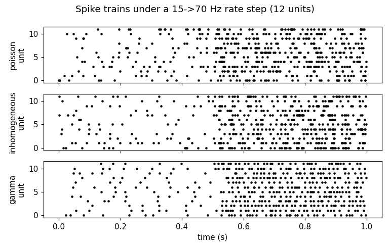

# Usage

Start simple; add detail only when you need it.

## The facade (recommended)

```python
from bioafferent import Afferents

aff = Afferents(n_muscles=2)  # n_muscles defaults to 1
out = aff.step(length=1.04, velocity=0.03, force=20.0)
out.ia_rate, out.ii_rate, out.ib_rate  # Hz, one entry per muscle
```

- `length` (L/L0), `velocity` (L0/s, positive = lengthening), `force` (N) are
  the only true inputs — they carry your simulation's live state. Each
  defaults to rest (`1.0`, `0.0`, `0.0`), so `Afferents().step()` alone
  reports baseline discharge.
- Everything else defaults: no gamma drive, `dt=0.001` s, built-in
  parameters, no spike encoding. Override per call
  (`gamma_static=40.0`, `dt=0.02`) or at construction
  (`encoder_config=EncoderConfig(mode="poisson")`, custom `SpindleConfig` /
  `GTOConfig`, `seed=...`).
- `aff.reset()` returns states to rest; `aff.reseed(seed)` restarts the
  spike-encoding random stream. With `encoder_config` set, `out.spikes`
  holds one boolean per afferent (Ia, II, Ib concatenated).



## Gymnasium in one line

```python
import gymnasium as gym
from bioafferent import wrap

env = wrap(gym.make("CartPole-v1"))
obs, _ = env.reset()
obs["ia_rate"], obs["ii_rate"], obs["ib_rate"]  # appended observations
```

`wrap` pairs consecutive observation entries as (position, velocity) joints
and models one agonist/antagonist muscle pair per joint — pass explicit
`joints=[(pos_idx, vel_idx), ...]` to override. Observations are a dict by
default (`observation_mode="concat"` recovers a flat Box). Match `dt` to the
env's control timestep so slow afferent states evolve at the right speed.

Envs that already compute muscle kinematics can use `DictInfoAdapter` with
`AfferentWrapper` directly (see `examples/`).

## MuJoCo / MJX

```python
from bioafferent.wrappers.mujoco import extract_mujoco_mechanics

mech = extract_mujoco_mechanics(data)  # every actuator; rest lengths measured
```

The MJX variant (`extract_mjx_mechanics`) is pure JAX — combine it with
`mjx_afferent_step` inside `jit`/`vmap`/`scan` with no host round-trips.

## Experts

The functional API (`MuscleSpindle`, `GolgiTendonOrgan`, `AfferentEncoder`)
exposes explicit immutable states, PRNG keys, and integrators for full
control. Formulation record: `physiology.md`. Architecture: `architecture.md`.
